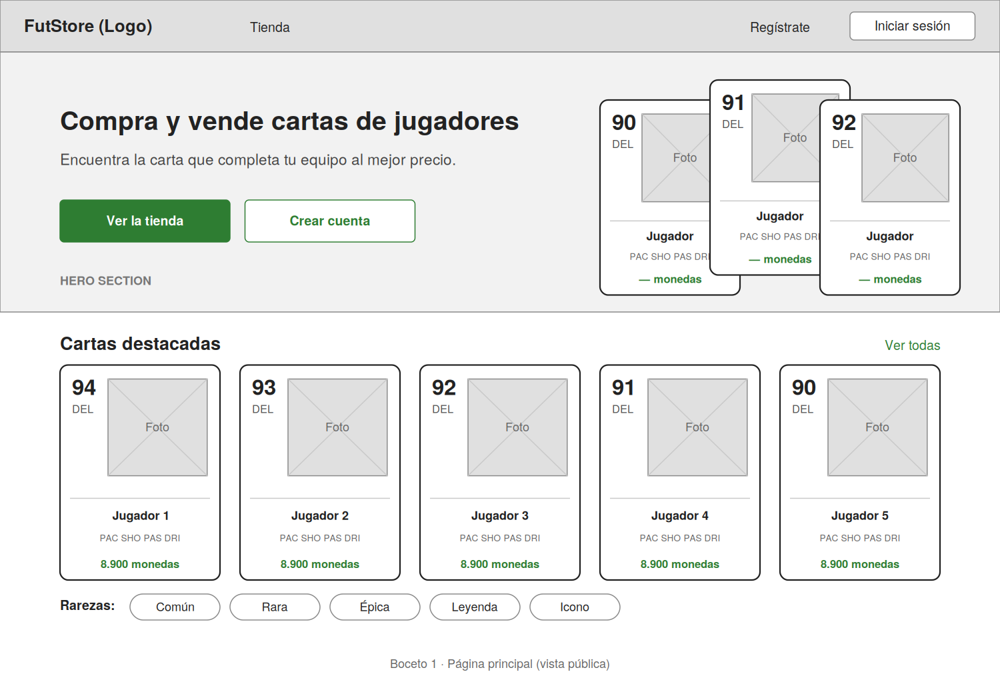
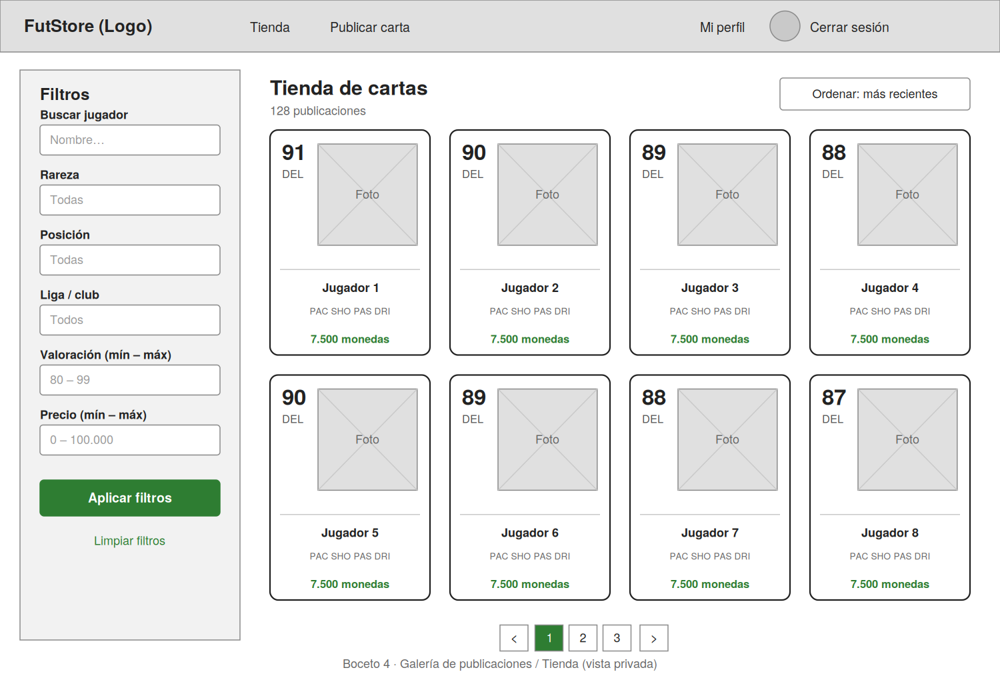
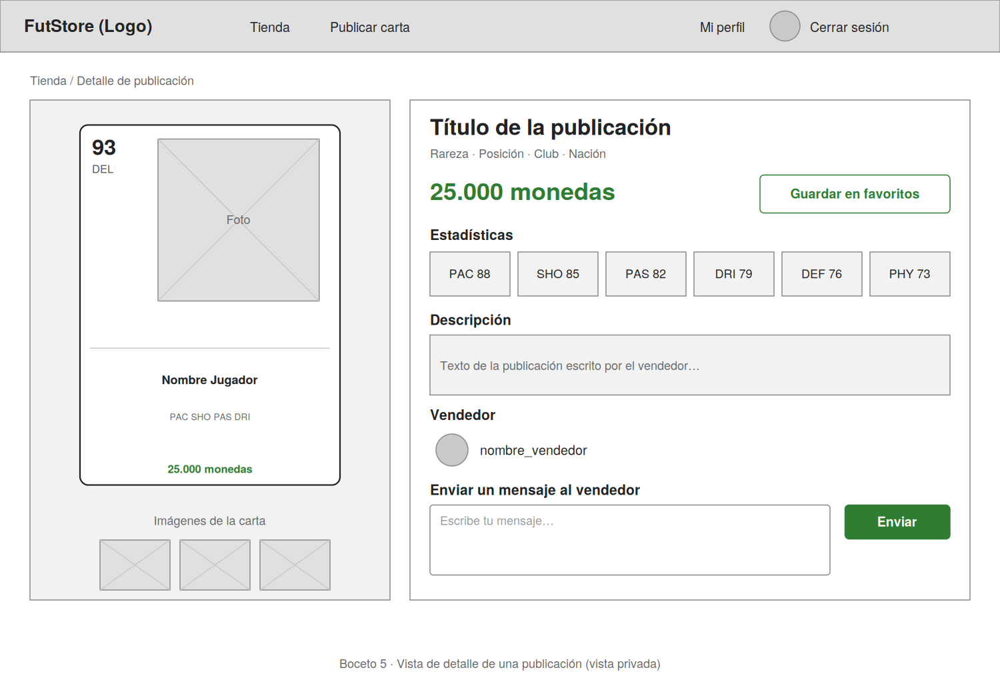
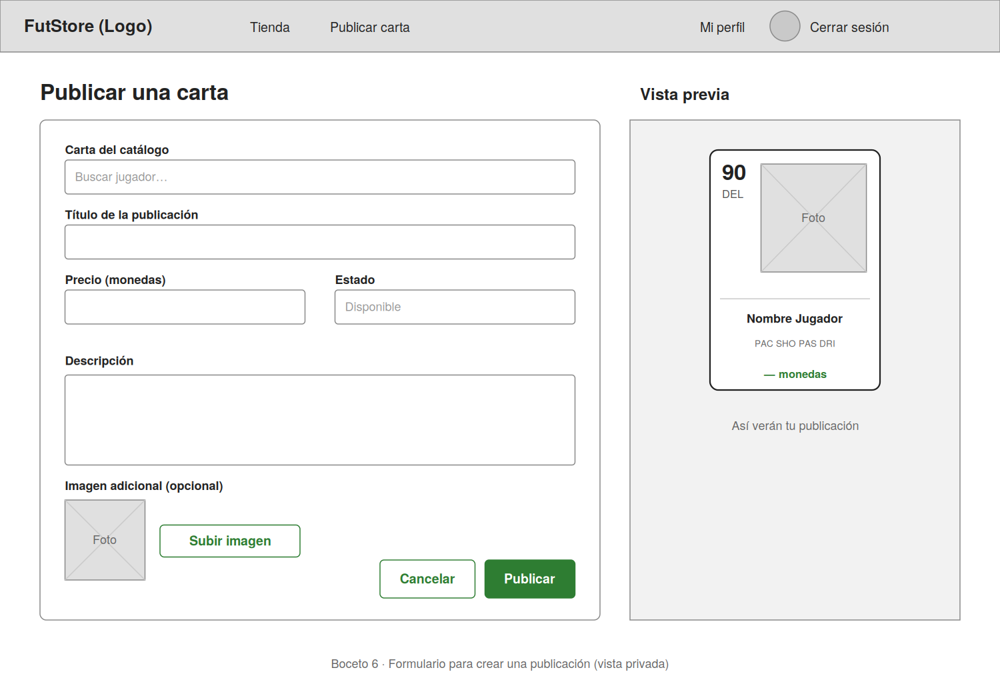
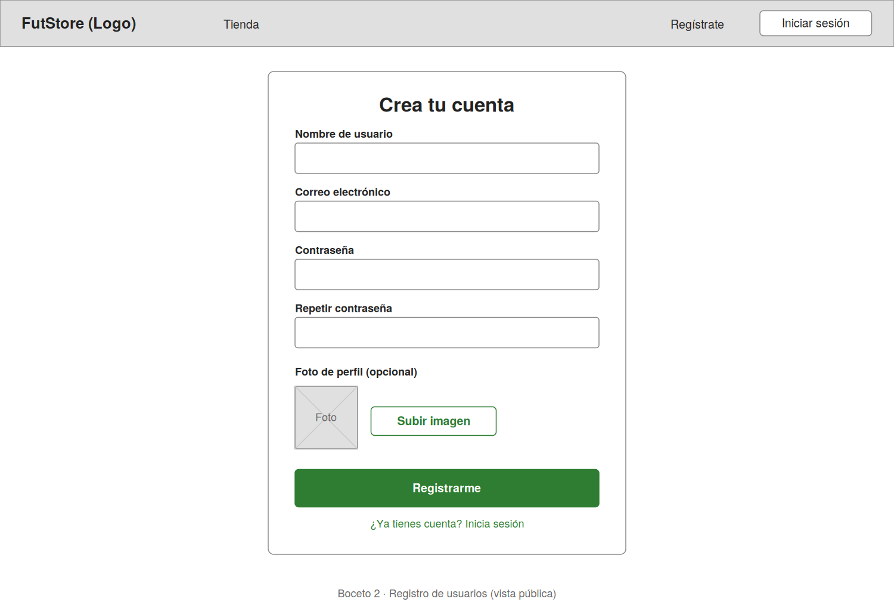
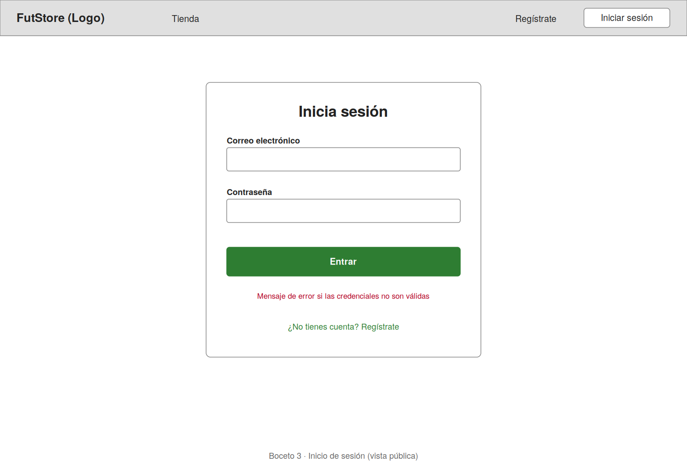
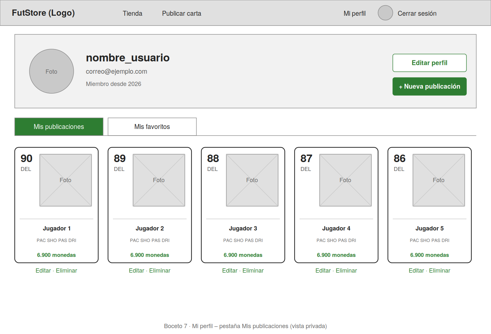
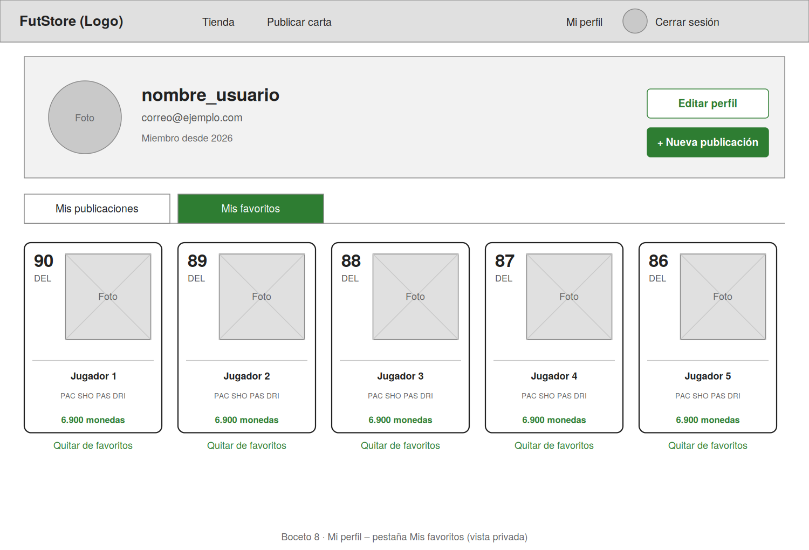

# 1 · Bocetos de las vistas

Cada boceto muestra la distribución de los componentes de la pantalla. Los archivos están en SVG (editable) y PNG (para visualizar rápido).

| Vista | Acceso | Archivo |
|-------|--------|---------|
| Página principal | Pública | [`01-pagina-principal.png`](01-pagina-principal.png) |
| Registro de usuarios | Pública | [`02-registro.png`](02-registro.png) |
| Inicio de sesión | Pública | [`03-inicio-sesion.png`](03-inicio-sesion.png) |
| Galería de publicaciones (tienda) | Privada | [`04-galeria-tienda.png`](04-galeria-tienda.png) |
| Vista de detalle de una publicación | Privada | [`05-detalle-publicacion.png`](05-detalle-publicacion.png) |
| Formulario para crear una publicación | Privada | [`06-crear-publicacion.png`](06-crear-publicacion.png) |
| Mi perfil · Mis publicaciones | Privada | [`07-mi-perfil-publicaciones.png`](07-mi-perfil-publicaciones.png) |
| Mi perfil · Mis favoritos | Privada | [`08-mi-perfil-favoritos.png`](08-mi-perfil-favoritos.png) |

## Componentes compartidos

- **Navbar pública:** logo, Tienda, Regístrate e Iniciar sesión.
- **Navbar privada:** logo, Tienda, Publicar carta, Mi perfil (con avatar) y Cerrar sesión.
- **Tarjeta de carta:** valoración, posición, foto, nombre, estadísticas resumidas y precio. Se reutiliza en la página principal, la tienda, el perfil y la vista previa del formulario.

