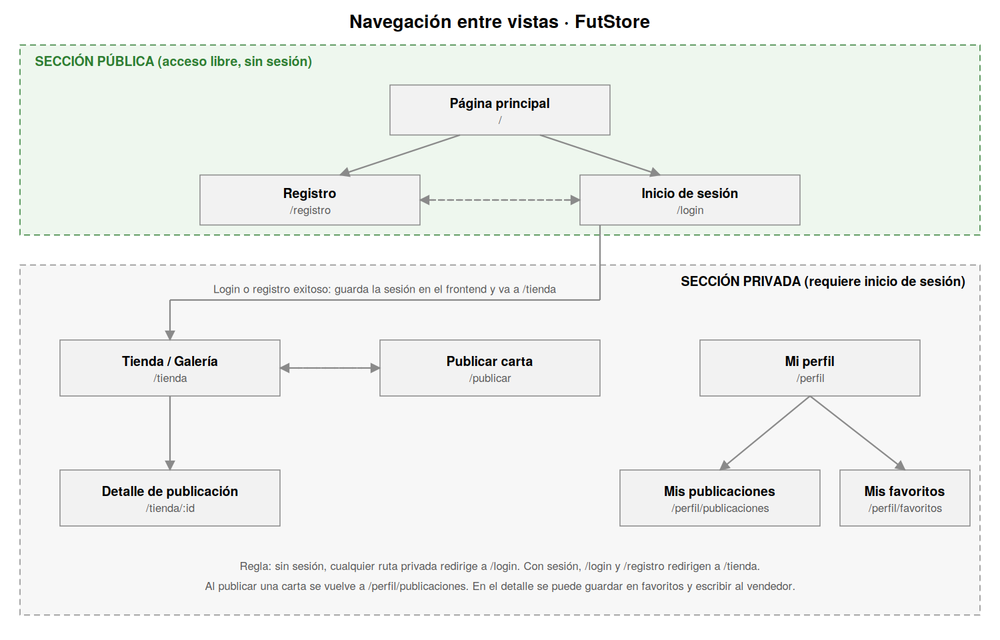

# 2 · Navegación entre vistas



## Vistas públicas (acceso libre)

| Vista | Ruta |
|-------|------|
| Página principal | `/` |
| Registro | `/registro` |
| Inicio de sesión | `/login` |

## Vistas privadas (requieren inicio de sesión)

| Vista | Ruta |
|-------|------|
| Tienda / galería | `/tienda` |
| Detalle de publicación | `/tienda/:id` |
| Publicar carta | `/publicar` |
| Mi perfil | `/perfil` |
| Mis publicaciones | `/perfil/publicaciones` |
| Mis favoritos | `/perfil/favoritos` |

## Cómo se controla el acceso

El frontend guarda los datos de sesión en una variable global (React Context):

```js
// UserContext
{
  token: "eyJhbGciOi...",
  user: { id: 1, username: "carlos", email: "carlos@mail.com", picture: "https://..." }
}
```

- Si `user` es `null`, cualquier ruta privada redirige a `/login`.
- Si hay sesión, `/login` y `/registro` redirigen a `/tienda`.
- La sesión se guarda también en `localStorage` para sobrevivir a una recarga.
- Cerrar sesión limpia el contexto y el `localStorage` y vuelve a `/`.
