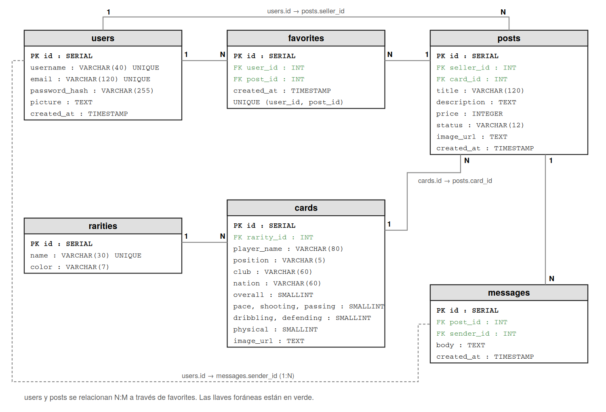

# 4 · Base de datos

Script completo: [`esquema.sql`](esquema.sql) (PostgreSQL).

## Tablas

| Tabla | Descripción |
|-------|-------------|
| `users` | Usuarios registrados. La contraseña se guarda encriptada en `password_hash`. |
| `rarities` | Rarezas de las cartas (Común, Rara, Épica, Leyenda, Icono) con su color. |
| `cards` | Catálogo de cartas de jugadores con valoración y estadísticas. |
| `posts` | Publicaciones: un usuario vende una carta del catálogo a un precio. |
| `favorites` | Publicaciones guardadas por cada usuario. |
| `messages` | Mensajes que un comprador envía al vendedor desde el detalle de una publicación. |

## Relaciones

| Relación | Tipo | Significado |
|----------|:----:|-------------|
| `users` → `posts` (`seller_id`) | 1:N | Un usuario puede tener muchas publicaciones |
| `users` ↔ `posts` vía `favorites` | N:M | Un usuario guarda muchas publicaciones y una publicación puede ser favorita de muchos |
| `rarities` → `cards` | 1:N | Una rareza agrupa muchas cartas |
| `cards` → `posts` | 1:N | Una carta del catálogo puede publicarse muchas veces |
| `posts` → `messages` | 1:N | Una publicación recibe varios mensajes |
| `users` → `messages` (`sender_id`) | 1:N | Un usuario envía varios mensajes |

## Reglas de integridad

- `users.email` y `users.username` son únicos.
- `favorites` tiene la restricción `UNIQUE (user_id, post_id)`: no se puede guardar dos veces la misma publicación.
- Al eliminar un usuario o una publicación se eliminan en cascada sus favoritos y mensajes.
- `posts.status` solo admite `available`, `paused` o `sold`.
